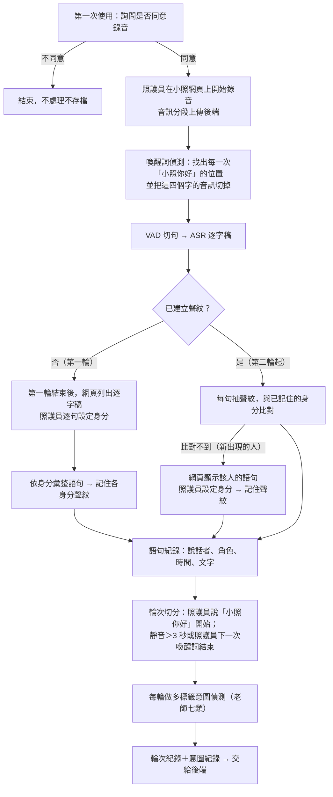

# 多人、多輪、多意圖：三層紀錄定義（草稿）

> 對應：《十月第一次會議紀錄_修改版》議題十、附錄二、待辦 8（期限 10/12）
> 性質：資料面定義文件，供 10/12 會議報告與追認；**不含實作**。後續實作依第 8 節拆成獨立任務，各自走 GD。
> 提案學生：吳佳杰　　版本：草稿 v0.5（2026-10-11：輪的結束條件加入「小照給我回答結果」；角色清單統一為照護員／家屬／長輩／督導／其他工作人員／未辨識，與 LIFF 設計 v0.7 一致；督導為 2026-10-11 新增）；v0.4（2026-10-07，改為網頁錄音（待老師同意）、新出現的人在網頁上設定身分）

## 1. 範圍與前提

- 收音（**提案，待老師同意**）：照護員從 LINE 開啟小照網頁，在網頁上錄音，網頁邊錄邊把音訊分段上傳後端處理。（LINE 單則語音實測可錄 15 分鐘以上，但須錄完才送出、才能開始處理。）會議議題四原定案為「照護員主動傳送之 LINE 語音訊息」，此變更須於 10/12 會議請老師同意（見第 7、9 節）。
- 一段錄音依序產生三層紀錄：**語句**（誰、何時、說了什麼）→ **輪次**（哪幾句是同一段問答）→ **意圖**（每輪裡誰要什麼）。
- 每一輪都由照護員說出喚醒詞「小照你好」開啟。
- **第一輪兼作聲紋建檔**：第一輪結束後，照護員在網頁上替這一輪的逐字稿逐句設定身分，系統記住各身分的聲紋；第二輪起以聲紋自動辨識說話者，不再詢問。
- 第一次使用前先詢問是否同意錄音；現階段只用提案學生本人（與同學）的模擬錄音，家屬、長輩的聲紋須待告知同意流程與 IRB 完成後才建立（會議範圍聲明（6）、待辦 10）。

## 2. 整體流程

## 3. 第一層：多人（語句）

### 3.1 第一輪：設定身分並記住聲紋

1. 照護員說「小照你好」開啟第一輪，現場對話照常進行，直到第一輪結束（見 4.1）。
2. 系統對第一輪 VAD 切句、ASR 轉逐字稿。
3. 照護員在**手機網頁**（小照網頁的「建檔」分頁，見第 8 節）上看這一輪的逐字稿，**逐句**設定說話者身分（照護員、家屬、長輩、督導、其他工作人員）。
4. 系統把同一身分的語句合併、抽取聲紋（嵌入向量）並記住。同一身分有效語音總長須達下限（建議 ≥ 5 秒，待實測）才算記住成功；不足時於下一輪結束後再請照護員補設定。
5. 第一輪還沒有聲紋，喚醒詞一律視為照護員所說（傳語音的 LINE 帳號即照護員本人）。

### 3.2 第二輪起：聲紋辨識

1. VAD 切句、ASR。
2. 每句抽聲紋，與第一輪記住的各身分比對，相似度最高且超過門檻者即為說話者；都不超過門檻視為新加入的人，記為「未辨識」，不硬猜（處理方式見第 4 點）。
3. 門檻沿用 Android 端分群起始值 0.5，待實測調整。
4. 新出現、沒記住過的人（例如中途來訪的家屬）：網頁顯示這個人說的語句，請照護員設定身分；設定後記住其聲紋，之後自動辨識。設定前其語句 `role` 暫記為「未辨識」。

### 3.3 語句紀錄欄位

| 欄位 | 說明 |
|---|---|
| `utterance_id` | 唯一編號 |
| `session_id` | 來源錄音（網頁上一次開始到結束的錄音） |
| `index` | 該段錄音內第幾句 |
| `start_s`、`end_s` | 起訖時間（秒，相對於錄音開始） |
| `text` | 逐字稿（繁體），不含「小照你好」 |
| `role` | 照護員／家屬／長輩／督導／其他工作人員（護理師、同事等）／未辨識。「未辨識」只用於偵測到新加入、尚未由照護員設定身分的人 |
| `role_source` | `manual`（照護員在網頁上設定：第一輪或新出現的人）／`voiceprint`（聲紋比對） |
| `speaker_score` | 聲紋比對分數；`manual` 時為 `null` |

驗收：DER（語者錯誤率）、CER（字錯誤率）；並報告角色判定的召回率。

## 4. 第二層：多輪（輪次）

### 4.1 定義

**一輪 = 照護員說出「小照你好」開始，至照護員說出「小照給我回答結果」、所有人回應結束（靜音超過 3 秒）或照護員下一次說出「小照你好」為止。**

例：

> 照護員：「小照你好」　← 第 1 輪開始
> 照護員：「今天感覺怎麼樣？」
> 長輩：「我肚子痛。」
> 家屬：「從昨天晚上就開始了。」
> （靜音超過 3 秒）　← 第 1 輪結束
> 照護員：「小照你好」　← 第 2 輪開始
> 照護員：「長輩說他肚子痛，要怎麼處理？」

操作化規則：

- **起始**：只要偵測到**照護員**說出「小照你好」，就開啟新的一輪；喚醒詞後面接什麼內容不影響判定。
  - 第二輪起，喚醒詞須同時符合「偵測到喚醒詞」與「該段聲紋判為照護員」才算數，避免家屬、長輩說到「小照你好」誤開新輪。
  - 沒有喚醒詞的話（包括照護員自己的問句）都**不會**開新輪，歸入當下進行中的輪。
- **結束**（先到者為準）：
  1. 照護員說出「**小照給我回答結果**」：立即結束本輪並播放回答（與「小照你好」相同，須聲紋判為照護員才算數）；
  2. VAD 偵測到靜音超過 **3 秒**（視為「所有人回應結束」）；
  3. 照護員再次說出「小照你好」：**強制結束**上一輪，同時開啟下一輪。
- 回應句（如長輩回答「我肚子痛」）屬於該輪，其內容交由第三層意圖偵測處理。
- **每一次**出現的「小照你好」「小照給我回答結果」都不做 ASR、不做意圖偵測（見 4.2）。
- 錄音開始後、第一次說「小照你好」之前的話，不屬於任何輪，也不做 ASR 與意圖偵測。例外（2026-10-13）：KWS 漏抓時，輪外片段只轉開頭 2 秒比對喚醒詞，結果不保存（`2026-10-13-ltc-awe-wake-word-miss-spike.md`）。

### 4.2 喚醒詞偵測

- **每一次**出現的「小照你好」這四個字都**不做 ASR（語音轉文字），也不做意圖偵測**，只用來標記輪的起點。
- 因此喚醒詞要在 ASR **之前**、直接對音訊偵測：用 sherpa-onnx 關鍵詞偵測（KWS）模型（Android 端 10/01 已驗證過 `sherpa-onnx-kws-zipformer-wenetspeech-3.3M`），取得喚醒詞的起訖時間，把這段音訊切掉，其餘才送 ASR。
  - 不採「先 ASR 再比對文字開頭」：那樣喚醒詞本身就做了 ASR，不符合上述規則。

### 4.3 輪次紀錄欄位

| 欄位 | 說明 |
|---|---|
| `turn_id` | 唯一編號 |
| `wake_word_at` | 喚醒詞出現位置（`session_id`＋秒數） |
| `utterance_ids` | 本輪包含的語句（依時間排序） |
| `is_enrollment` | 是否為設定身分、記住聲紋的第一輪 |
| `status` | `open`（尚未結束）／`closed` |
| `end_reason` | `answer_keyword`（小照給我回答結果）／`silence_3s`／`next_wake_word`／`session_stop`（照護員停止錄音） |

驗收：輪次邊界 F1；兩位標註者對邊界的一致性併入 SOP-1。

## 5. 第三層：多意圖（意圖）

### 5.1 類別：老師的七類（取代現有標籤）

現有 `exported_model/labels.txt`（7 類）與 `data/sample/labels.json`（9 類）**全部改為**下列七類。定義為草擬，待老師確認：

| 類別 | 草擬定義 | 例 |
|---|---|---|
| 規範詢問 | 詢問規定、流程、資格、費用等制度面問題；含照護員向主管或家屬詢問規定 | 「居家服務一週可以來幾次？」「居服可以幫忙買菜嗎？」 |
| 服務請求 | 請對方做某件事或提供某項服務 | 「幫我把輪椅推過來」 |
| 拒絕或抗拒 | 不願配合、拒絕照護或建議 | 「我不要洗澡」 |
| 身體不適陳述 | 陳述疼痛、不舒服或身體異狀；**暫採方案 (b) 擴大為「身體狀況陳述或詢問」**，含未陳述症狀的健康狀況詢問（待 10/12 老師確認） | 「我肚子痛」「我的血壓會不會太高啊」「有沒有哪裡不舒服」 |
| 情緒安撫或閒聊 | 安撫情緒、寒暄、與照護無直接關係的聊天 | 「不要緊張，慢慢來」 |
| 資訊告知或交接 | 告知事實、交接照護資訊；含照護員告知自己要做的照護動作（「我幫你 X」），句中附帶的配合指示不另計 | 「她早上已經吃過藥了」「我幫你剪指甲，手伸出來不要動」 |
| 確認或同意 | 確認對方意思或表示同意 | 「好，可以」 |

### 5.2 判定方式

- 以**輪**為單位，一輪可有多個意圖（多標籤）；每句先判一個類別，再彙整到輪。
- 每個意圖記錄歸屬角色，例：照護員問「今天感覺怎麼樣？」→ 長輩答「我肚子痛」→ 該輪含「身體不適陳述」，歸屬長輩。
- **限制：模型只看單句**（2026-10-11 補記）。意圖模型（BERT A1）一次只讀一句，看不到前後文；例如家屬說「從昨天晚上就開始了」，單獨看是資訊告知，放回對話裡其實是在補充「肚子痛」的症狀。改善方向是一次讀整輪對話再判定，但訓練資料須改以「輪」為單位標註（care7 目前是單句），須先有 SOP-1 的整輪標註資料，且屬新開發、須另走 GD。先以 SOP-1 標註量測「單句判定＋彙整」與人工標註的差距，差距大再提整輪模型。

### 5.3 意圖紀錄欄位

| 欄位 | 說明 |
|---|---|
| `turn_id` | 所屬輪次 |
| `label` | 七類之一 |
| `role` | 歸屬角色 |
| `evidence_utterance_ids` | 判定依據的語句 |
| `confidence` | 信心分數 |

### 5.4 訓練與評估

- 依七類重新撰寫／標註模擬語句，資料切為**訓練、驗證、測試**三份；準確率一律報**測試集**（模型未見過的資料），不以訓練集報告。
- 指標：準確率（門檻沿用 0.80）、逐類 F1、歸屬正確率。

## 6. KPI 與延遲

- 召回率分三層量測：語者歸屬、輪次邊界、意圖類別（議題十）。
- 延遲：LINE 收到訊息至回覆送達 LINE，P95 ≤ 3 秒（議題二）。
- 已知數據（2026-10-07 離線試跑，筆電 CPU）：71.8 秒音檔切句＋ASR 約 4.0～4.6 秒（RTF ≈ 0.06），尚未含語者辨識；單則 60 秒上限下是否能達 3 秒，待加上聲紋比對後實測。

## 7. 與會議紀錄的差異（請 10/12 追認）

| 項目 | 會議紀錄（附錄二） | 本文件 | 理由 |
|---|---|---|---|
| 收音方式 | 照護員主動傳送 LINE 語音訊息（錄一段再傳），非持續收音（議題四） | 在小照網頁上錄音，邊錄邊分段上傳處理 | 2026-10-07 實測 LINE 單則語音可錄 15 分鐘以上，長度本身不是限制；差別在 LINE 語音要**錄完才送出**，長錄音只能整段錄完後才開始處理，等待時間隨長度增加，網頁可邊錄邊處理；**須老師同意** |
| 照護員聲紋 | 照護員預先註冊，直接比對 | 不預先註冊；第一輪結束後與家屬、長輩一起由照護員設定身分 | 不需另外的註冊步驟，照護員只操作一次 |
| 指定身分方式 | 累積一段對話後系統分群列出發言人，以 LINE 選單指定 | 第一輪結束後在網頁上逐句設定；之後新出現的人也在網頁上設定 | 人工確認的語句當聲紋樣本較準；LINE 聊天室難以逐句列出並選擇 |
| 輪的起始 | 以問句或請求起始，未限定說話者 | **只要照護員說出「小照你好」**就開新輪 | 邊界明確、可用聲紋確認是照護員，不需判斷哪句是問句 |
| 輪的結束 | 下一個起始句、靜默超過設定秒數或訊息結束 | 照護員說「小照給我回答結果」、靜音超過 3 秒，或照護員下一次喚醒詞（強制結束上一輪） | 改為網頁連續錄音後，不再有「訊息結束」 |
| 喚醒詞用途 | 照護員開啟喚醒偵測後，偵測到才進入後續處理 | 作為每一輪的起始點；「小照你好」本身不做 ASR、不做意圖偵測 | 一個機制同時解決「何時處理」與「輪從哪裡開始」 |
| 輪的靜默秒數 | 待實測後訂定 | 初始值 3 秒，待實測調整 | 先有可操作的數值 |
| 意圖標籤 | 補入長照服務分類 | 全面改為老師七類（會議紀錄「確認獲同意」為誤植，應為「確認或同意」） | 依提案學生決定 |

## 8. 後續任務（各自走 GD，不在本文件範圍）

1. **LINE 語音 → 切句 → ASR spike**：設計已完成（`2026-10-05-ltc-awe-linebot-asr-spike.md`），待老師核可。若老師同意改為網頁錄音，此 spike 的「收 LINE 語音」部分改為「網頁錄音分段上傳」，切句與 ASR 部分不變。
2. **小照網頁（LIFF，多分頁）＋網頁錄音＋語者辨識＋聲紋**：一個從 LINE 開啟、以 LINE 帳號登入的網頁；「錄音」與「設定身分」（顯示逐字稿、逐句選身分）為最初的分頁，之後的功能都以新分頁加在同一個網頁上。須先實測 LINE 內建瀏覽器（iOS／Android）能否取得麥克風權限並長時間錄音。新增對外網頁、LINE Login 身分驗證、生物特徵資料存放，預估 Tier B。
3. **七類意圖資料集重建與重新訓練**：本機模擬資料，預估 Tier C。
4. **喚醒詞偵測與輪次切分**：KWS 偵測並切除喚醒詞音訊、依第 4 節規則切輪，以標註資料量測。

## 9. 未決問題

1. **改為網頁錄音須老師同意**：與議題四「收音形式為照護員主動傳送之 LINE 語音訊息」不同，10/12 會議提出。
2. 網頁錄音的單次長度上限：不受 LINE 限制後，仍需設上限或分段處理，否則轉文字時間隨長度增加，無法達到 3 秒 P95（議題二、附錄一）。
3. LINE 內建瀏覽器能否錄音、螢幕關閉或切到其他 App 時是否中斷，須實測。
4. 錄音同意的對象是在場所有人；家屬、長輩的告知同意流程由吳明叡設計（待辦 10）。
